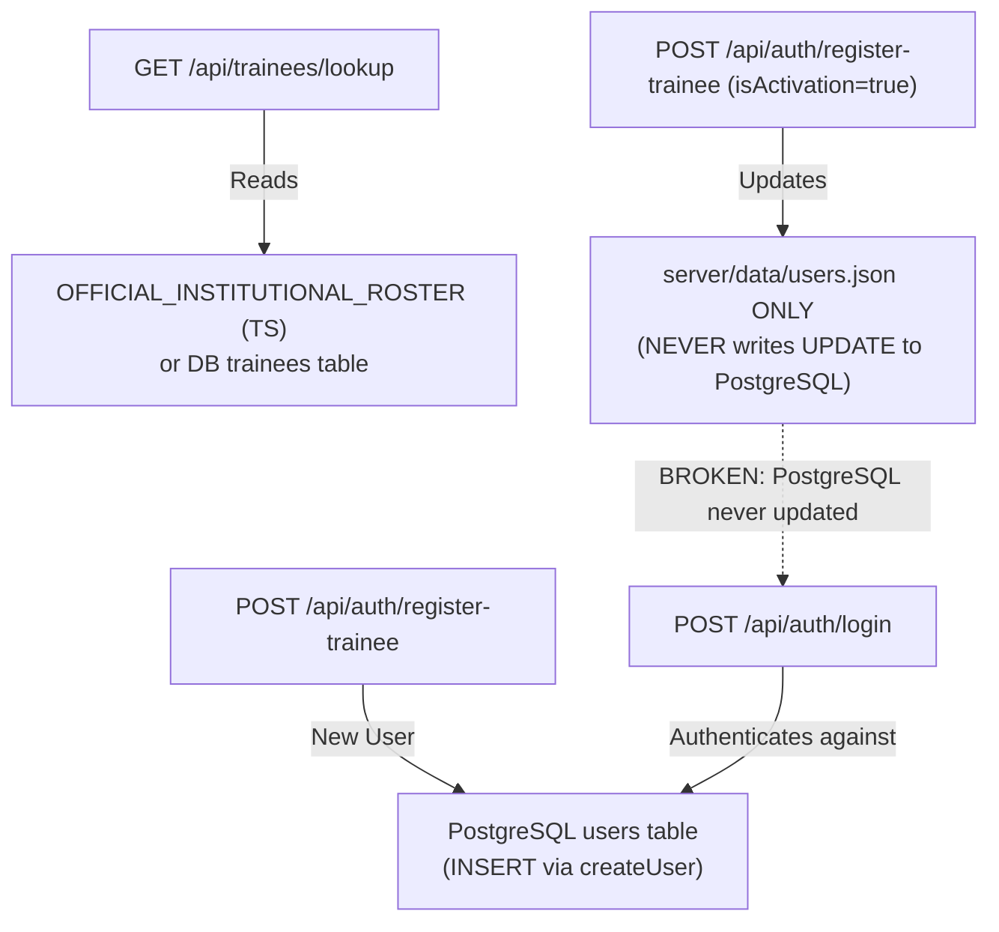

# Data Flow & Authoritative Store Map

> **Generated:** 2026-10-29  
> **System:** Mukiria Technical Training Institute (MTTI) Academic ERP & Assessment Engine  
> **Scope:** Multi-Store Data Flow, PostgreSQL vs JSON Fixtures vs LocalStorage, Synchronization Gaps  

---

## 1. Entity Store & Authority Mapping

| Entity | Competing Stores | Authoritative Store | Write Path & Gaps | Read Precedence |
| :--- | :--- | :--- | :--- | :--- |
| **Users / Staff Accounts** | `users` table (Postgres/Supabase), `server/data/users.json`, `localStorage.mtti_demo_session` | **`users` table** (Migration 15) | **CRITICAL GAP:** Trainee activation (`/api/auth/register-trainee` with `isActivation: true`) only calls `savePersistentUsers()` which writes to `users.json`. **It never updates Postgres `users` table.** | 1. Postgres `users`<br>2. `users.json` (fallback)<br>3. Hardcoded aliases |
| **Trainees / Roster** | `trainees` table (Postgres), `OFFICIAL_INSTITUTIONAL_ROSTER` (TS code), `DB.trainees` (TS code), `server/data/trainees.json`, `database/seeds/trainees.json`, `localStorage.mtti_trainees` | **`trainees` table** (Migration 01) | **DISCONNECTION:** `POST /api/trainees` writes to Postgres if `pool` exists, but also appends to in-memory `DB.trainees` and `server/data/trainees.json`. If Postgres connection fails in non-strict mode, returns success without DB persistence. `OFFICIAL_INSTITUTIONAL_ROSTER` has 89 hardcoded trainees that shadow DB records. | 1. `OFFICIAL_INSTITUTIONAL_ROSTER`<br>2. `DB.trainees`<br>3. `server/data/trainees.json`<br>4. Postgres `trainees` |
| **Continuous Assessment Marks** | `assessment_marks` table, `server/data/assessment_marks.json`, `database/seeds/assessment_marks.json` | **`assessment_marks` table** (Migration 03) | **SPLIT STORAGE:** Batch marks save through `saveAssessmentMarksBatch()`. If `pool` exists, executes Postgres upsert. However, in-memory `DB.assessment_marks` and JSON are updated independently. No database-level transaction rollback if JSON write fails. | 1. In-memory `DB.assessment_marks`<br>2. `assessment_marks.json`<br>3. Postgres `assessment_marks` |
| **Attendance Records** | `attendance_register` table, `server/data/attendance_register.json`, `database/seeds/attendance_register.json`, `localStorage` | **`attendance_register` table** (Migration 02) | **SPLIT STORAGE:** Single marks and bulk attendance write to Postgres and JSON. `GET /api/attendance` loads from JSON fixture `loadPersistentAttendance()` and merges with in-memory array. Postgres is queried only if `pool` is active. | 1. In-memory array<br>2. `attendance_register.json` (738 rows)<br>3. Postgres `attendance_register` |
| **Exam Submissions & Responses** | `submissions` table, `server/data/submissions.json`, `database/seeds/submissions.json`, `localStorage` | **`submissions` table** (Migration 04) | **CRITICAL INTEGRITY GAP:** `GET /api/submissions` returns in-memory `DB.submissions` merged with Postgres. If `req.user` is undefined, unauthenticated callers receive all 33+ submissions with student exam answers and grades. | 1. Postgres `submissions`<br>2. `DB.submissions`<br>3. `submissions.json` |
| **Session Plans** | `session_plans` table, `server/data/session_plans.json`, `database/seeds/session_plans.json` | **`session_plans` table** (Migration 08) | Writes to Postgres via `savePersistentSessionPlans()`. Also writes to JSON file. | 1. In-memory array<br>2. `session_plans.json` (8 rows)<br>3. Postgres |
| **Learning Plans** | `learning_plans` table, `server/data/learning_plans.json`, `database/seeds/learning_plans.json` | **`learning_plans` table** (Migration 08) | Writes to Postgres via `savePersistentLearningPlans()`. Seed JSON in `server/data` and `database/seeds` differ in byte contents. | 1. In-memory array<br>2. `learning_plans.json`<br>3. Postgres |
| **Records of Work** | `records_of_work` table, `server/data/records_of_work.json`, `database/seeds/records_of_work.json` | **`records_of_work` table** (Migration 08) | Dual write to Postgres and JSON. | 1. In-memory array<br>2. `records_of_work.json`<br>3. Postgres |
| **Class Registers** | `class_registers` table, `server/data/class_registers.json`, `database/seeds/class_registers.json` | **`class_registers` table** (Migration 08) | Dual write to Postgres and JSON. Seed JSON differs between server and database directories. | 1. In-memory array<br>2. `class_registers.json`<br>3. Postgres |
| **Assessment Evidence** | `assessment_evidence` table, `server/data/assessment_evidence.json`, `database/seeds/assessment_evidence.json` | **`assessment_evidence` table** (Migration 14) | Base64 file payloads are stored directly in Postgres and duplicated into JSON on disk. Unauthenticated `DELETE /api/evidence/:id` deletes from in-memory, disk, and database. | 1. In-memory `DB.assessment_evidence`<br>2. Postgres `assessment_evidence` |

---

## 2. Authentication & Verification Data Flow Disconnections

### A. Trainee Registration vs Lookup vs Activation vs Login


- **The Root Cause of Activation Failure:**
  When a trainee attempts to activate their account (e.g., Cynthia Nkatha, or any candidate in `OFFICIAL_INSTITUTIONAL_ROSTER`), `/api/auth/register-trainee` finds their existing record via `findUserByAdmissionNumber(admission_number)`. Because `isActivation: true`, lines 657-674 execute:
  ```typescript
  existingAdm.password_hash = password_hash;
  if (phone_number) existingAdm.phone_number = phone_number;
  if (full_name) existingAdm.full_name = full_name;
  existingAdm.updated_at = new Date().toISOString();
  const allUsers = loadPersistentUsers();
  savePersistentUsers(allUsers);
  ```
  This saves exclusively to `server/data/users.json`. No SQL `UPDATE users SET password_hash = ... WHERE id = ...` is ever executed. Subsequent logins query PostgreSQL `SELECT * FROM users WHERE ...`, find the unactivated record or unhashed password, and fail with HTTP 401 `Unauthorized: Invalid credentials`.

### B. Staff & Demo Authentication Divergence
- **Admin, HOD, and Trainer Login:**
  - Login via `/api/auth/login` authenticates against PostgreSQL `users` table using bcrypt.
  - However, in development or when `AUTH_MODE=demo` or `ALLOW_DEMO_AUTH=true` is active, users can bypass login entirely using hardcoded tokens:
    - `token-admin` (Admin)
    - `token-hod-ci` / `token-hod-ee` (HOD)
    - `token-trainer-001` / `token-trainer-002` (Trainers)
    - `token-trainee-001` (Trainee)
  - In addition, the frontend (`AuthContext.tsx`, `AdminDashboard.tsx`, `CandidatePortal.tsx`) sends `x-user-role: admin`, which line 265 of `server/auth.ts` blindly trusts whenever `allowDemoAuth` is true, creating synthetic staff sessions without any password or database check.

---

## 3. Client-Call vs. Server-Route Cross-Reference

### A. Dead Client Calls (Endpoints called by Client that DO NOT EXIST on Server)
The client attempts to `fetch()` 13 routes that have **no handler** defined on `server/routes.ts`. In production and local development, these calls fail with HTTP 404 `Endpoint not found: METHOD /api/...`:

| Client Endpoint Called | Calling Client File(s) | Impact / Manifestation |
| :--- | :--- | :--- |
| `POST /api/parse-doc` | `IntelligentDropzone.tsx`, `AcademicWorkspaceShell.tsx` | Drag-and-drop syllabus/document parsing silently fails |
| `POST /api/generate-qr` | `WorkshopDoorQRModal.tsx` | Workshop door QR code generation modal fails |
| `GET /api/curriculum/departments` | `curriculumDatabase.ts` | Curriculum department fetching fails, falls back to local mocks |
| `GET /api/curriculum/units:param` | `curriculumDatabase.ts` | Curriculum unit list fails, falls back to local mocks |
| `GET /api/curriculum/unit/:param` | `curriculumDatabase.ts` | Unit detail query fails |
| `POST /api/curriculum/rescan` | `curriculumDatabase.ts` | Curriculum re-index trigger fails |
| `POST /api/export-session-plan` | `AcademicWorkspaceShell.tsx` | Backend session plan document export fails |
| `POST /api/auto-grade` | `AutoGrading.tsx` | Automated AI/scripted grading trigger fails |
| `POST /api/generate-exam` | `ExamBuilder.tsx` | Exam auto-generator fails |
| `POST /api/export-docx` | `ExamBuilder.tsx` | Exam DOCX export fails |
| `POST /api/export-exam-results-docx` | `HODReports.tsx` | HOD exam performance DOCX report export fails |
| `POST /api/export-learning-plan` | `LearningPlan.tsx` | Learning plan document export fails |
| `POST /api/merge-row-pdf` | `RecordsOfWork.tsx` | Record of Work PDF consolidation fails |

### B. Orphan Server Routes (Routes defined on Server that NO Client Page Calls)
The following endpoints exist on `server/routes.ts` but have zero callers in `client/src`:

| Server Route | Method | Declared Purpose |
| :--- | :---: | :--- |
| `/api/pedagogy/sign-off` | POST | HOD pedagogical approval endpoint (aliased to `/api/hod/sign-off`) |
| `/api/hod/sign-off` | POST | HOD pedagogical approval endpoint |
| `/api/pedagogy/record-of-work/:id` | PUT | Direct pedagogical record of work update |
| `/api/evidence/:id/verify` | PUT | Trainer assessment evidence verification |
| `/api/evidence/:id/grade` | PUT | Trainer assessment evidence grading |
| `/api/evidence/:id` | DELETE | Assessment evidence deletion |

---

## 4. Fixture Discrepancy Analysis (`server/data` vs. `database/seeds`)

A byte-by-byte and record-count comparison between `server/data/*.json` and `database/seeds/*.json` reveals active desynchronization across fixtures:

| File Name | `server/data` Count | `database/seeds` Count | Status | Notes |
| :--- | :---: | :---: | :--- | :--- |
| `users.json` | 20 records | *Missing* | **Orphan Store** | Exists only in `server/data/users.json`. Missing from database seeds. |
| `assessment_marks.json` | 3 records | 3 records | **DIFFERENT** | Schema structure and timestamp differences between copies. |
| `class_registers.json` | 1 record | 1 record | **DIFFERENT** | Attendance payload content and updated timestamps differ. |
| `learning_plans.json` | 1 record | 1 record | **DIFFERENT** | Session topic metadata and date keys diverge. |
| `submissions.json` | 33 records | 33 records | **DIFFERENT** | Graded answers, marks, and evaluation comments differ between copies. |
| `attendance_register.json` | 738 records | 738 records | Identical | Exact byte match across both directories. |
| `records_of_work.json` | 8 records | 8 records | Identical | Exact byte match across both directories. |
| `session_plans.json` | 8 records | 8 records | Identical | Exact byte match across both directories. |
| `trainees.json` | 3 records | 3 records | Identical | Exact byte match across both directories. |
| `assessment_evidence.json` | 2 records | 2 records | Identical | Exact byte match across both directories. |
